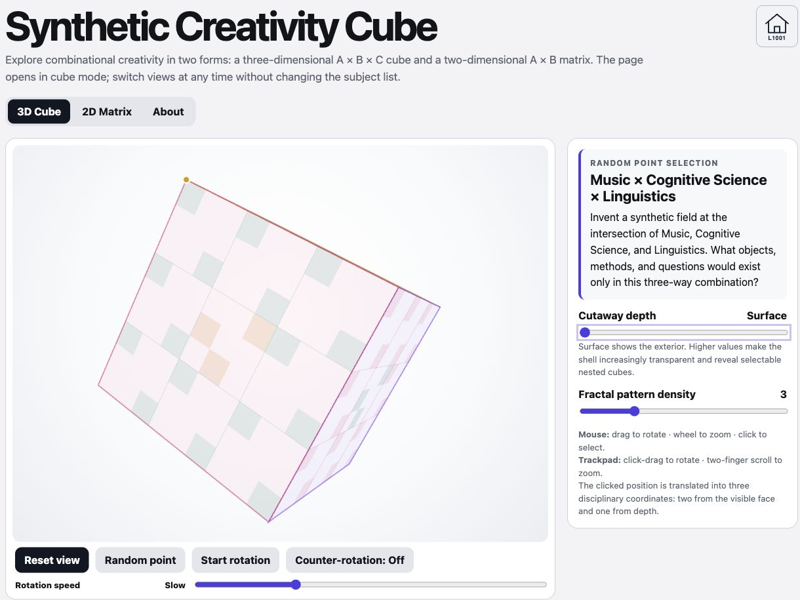
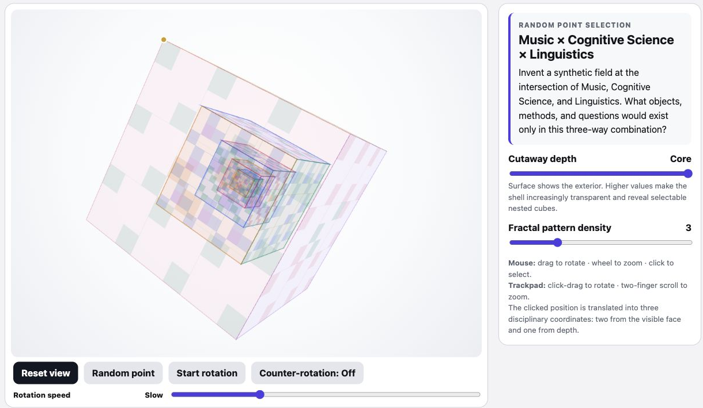
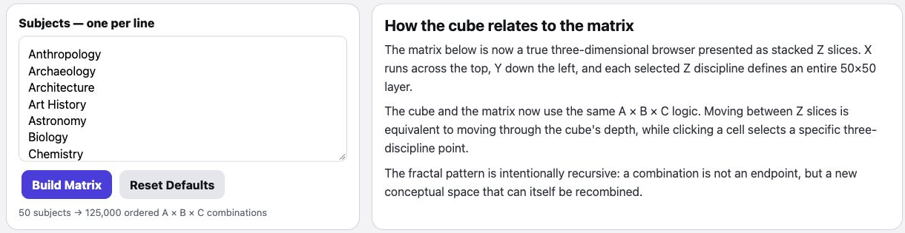
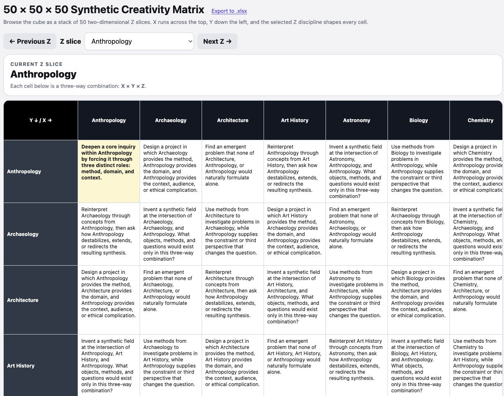
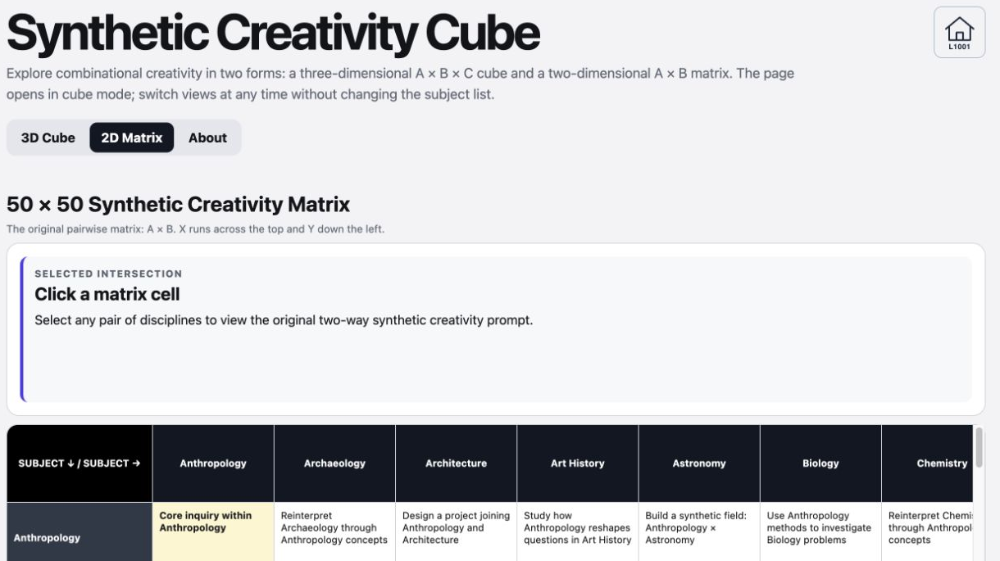

# Synthetic Creativity: Navigating Ordered Combinations of Disciplines

William Taggart  
Modern and Classical Languages and Literatures, Virginia Tech  
wtaggart@vt.edu

November 14, 2026

## Abstract

Synthetic Creativity is a self-contained browser application for exploring interdisciplinary prompts through a two-dimensional matrix and a three-dimensional cube. Ordered pairs and triples of disciplines select deterministic role-based templates; cube rotation, cutaway depth, Z slices, and spreadsheet export offer complementary ways to inspect the combination space. The system uses no language-model service and makes no automatic judgment of novelty or value. This report develops its combinatorial model, interaction mapping, export structure, and limitations from the implementation.

## Purpose and Research Context

Synthetic Creativity offers an interactive way to explore interdisciplinary questions by assigning different roles to familiar fields: one provides a method, another a problem domain, and a third a context or constraint. The application makes that assignment explicit and repeatable through an ordered discipline matrix and cube. Its purpose is to provide candidates for interpretation and development, with the usefulness and validity of a combination left to the person exploring it.

This design connects combinatorial exploration to established accounts of creativity. Boden distinguishes mechanisms that include recombining familiar ideas ([Boden, 1998](https://doi.org/10.1016/S0004-3702(98)00055-1)), Creative Cognition examines processes supporting invention ([Finke et al., 1992](https://mitpress.mit.edu/9780262061506/creative-cognition/)), and Mednick relates creativity to bringing ideas into new associations ([Mednick, 1962](https://doi.org/10.1037/h0048850)). The application turns such encounters into an inspectable interaction space, while treating the generation of a combination as the beginning of inquiry rather than evidence of creative achievement.

*Figure 1. A selected ordered triple in the cube: Music, Cognitive Science, and Linguistics.*

The ordered roles matter because a useful interdisciplinary connection involves more than substituting discipline names. Gentner's structure-mapping theory emphasizes correspondences between relations ([Gentner, 1983](https://doi.org/10.1207/s15516709cog0702_3)), and research on analogical encoding examines learning through comparison ([Gentner et al., 2003](https://doi.org/10.1037/0022-0663.95.2.393)). Rhoten, O'Connor, and Hackett similarly consider integrative creativity in collaborative disciplinary work ([Rhoten et al., 2009](https://doi.org/10.1177/0725513608099121)). These perspectives motivate prompts that invite users to explain what transfers between domains and where an analogy fails, rather than assuming that any juxtaposition yields a sound question.

The interface's spatial organization must be interpreted with the same care. Research on scientific impact associates influential work with combinations of conventional and atypical knowledge ([Uzzi et al., 2013](https://doi.org/10.1126/science.1240474)), while design research examines whether conceptually distant inspiration produces better ideas ([Chan et al., 2015](https://doi.org/10.1016/j.destud.2014.08.001)). Neither warrants a rule that more distant disciplines always produce more useful results. In this implementation, cube adjacency follows list order; its spatial distance is not a measured distance between concepts.

Shneiderman frames creativity-support tools around exploration and discovery ([Shneiderman, 2007](https://doi.org/10.1145/1323688.1323689)), suggesting that evaluation should follow the ideas users develop rather than the number of available cells. Doshi and Hauser's AI-assisted writing experiment also distinguishes individual gains from reduced collective diversity ([Doshi et al., 2024](https://doi.org/10.1126/sciadv.adn5290)). Although Synthetic Creativity uses deterministic prompts rather than an LLM, that distinction remains useful: an interface can help individuals while channeling many people toward similar outputs. The report accordingly describes the combinatorial model, prompt generation, navigation, and export mechanisms, while leaving novelty, feasibility, disciplinary validity, and diversity to subsequent human-centered evaluation.

## Combinatorial model

Let D be the ordered list of n subjects. The matrix indexes the Cartesian product D times D, and the cube indexes D times D times D. There are therefore n squared pair positions and n cubed triple positions, including combinations in which subjects repeat. With the default 50 disciplines, these counts are 2,500 and 125,000. They count ordered positions, not unique useful ideas.

Order matters because the templates assign roles. A field used as a method can yield a different question from the same field used as a domain or ethical complication. Repeated disciplines remain available as self-reflection rather than being removed as duplicates of cross-disciplinary combinations. A diagonal entry asks about a field's core inquiry instead of pretending that identical labels introduce independent expertise.

The displayed three-dimensional coordinates are indices in this combinatorial structure. They are not learned embeddings, estimates of similarity, emotional coordinates, or distances between disciplines. Adjacent positions primarily reflect the subject-list order. This limits any inference from visual proximity: two neighboring cells are not necessarily conceptually close.

## Deterministic prompt generation

The pair generator selects one of five templates by adding row and column indices and taking the remainder modulo five. The triple generator uses the remainder of seven times the first index, eleven times the second, and thirteen times the third, again modulo five. Substitution inserts subject names into roles such as method, domain, context, audience, or constraint. Special cases handle identical subjects.

Given an unchanged list and indices, the prompt is reproducible without a network call. Reordering the subject list changes both the mapping of names to positions and the template selector. Thus reproducibility requires preserving the ordered list as well as the selected coordinates. The generator contains no language model, semantic retrieval, novelty filter, or learned ranking function. Its variability comes from position and template selection.

*Figure 2. The core cutaway exposes nested cubes while retaining the selected disciplinary prompt.*

## Cube interaction and selection

The browser draws the cube on a canvas. Users can rotate it by dragging, zoom, select a visible face, request a random point, start or pause rotation, and control counter-rotation. Face selection maps projected coordinates back to discrete indices; cutaway depth supplies the remaining layer. Index values are quantized and bounded to the valid subject range. Random selection chooses indices rather than searching for a particularly creative combination.

The cutaway display exposes nested cubes, with surface and core views and a density control. These nested structures support navigation and visual orientation. They do not increase the number of subject combinations beyond n cubed or add new inferred dimensions. The selected prompt appears alongside the visualization, so the user can read the role assignment independently of the rotating object.

## Editing subjects and inspecting slices

Users enter one subject per line. The application trims lines and removes case-insensitive duplicates before rebuilding the matrix. Reset defaults restores the supplied disciplinary list. This permits smaller workshop-specific vocabularies or lists of methods, materials, and problems, although the built-in prompt wording still reflects the application's disciplinary framing. An empty or unsuitable vocabulary cannot be made meaningful by the cube representation alone.

*Figure 3. The editable discipline list and its relationship to the three-dimensional matrix.*

A Z slice fixes the third index and presents all n squared combinations of the remaining two indices as a table. Previous and next controls move through layers, and selecting a cell exposes its prompt. This is an alternative inspection surface for the same ordered triples, not a separate generative process. The cube emphasizes orientation and exploration, whereas the table permits systematic scanning and comparison.

*Figure 4. A Z-slice view exposes ordered triples as a two-dimensional table and offers spreadsheet export.*

The separate two-dimensional mode operates on pairs. It has its own selected-cell question and matrix, and it uses the pair template rules rather than silently discarding the third role from a triple prompt. At the default list size, either table is already dense; zoom and viewport size affect legibility. Large custom lists therefore impose a practical usability limit even before computation becomes expensive.

## Spreadsheet export and computational costs

The three-dimensional export generates an XLSX workbook with one worksheet per Z layer. Worksheet names are sanitized and constrained to the spreadsheet format's name length. Each sheet contains the corresponding grid of pair coordinates with the third subject fixed, making the full cube available outside the browser. The implementation creates the required workbook XML and ZIP container without a separate spreadsheet library.

*Figure 5. The separate two-dimensional matrix generates pairwise prompts rather than three-way prompts.*

A visible slice needs work proportional to n squared, while full-cube export must enumerate n cubed prompts. Doubling the list length multiplies the conceptual cube and export workload by eight. These are asymptotic consequences of the implemented enumeration, not measured browser benchmarks. The application has no backend queue or external storage service to absorb that cost; large exports consume client memory and processing time.

Exported questions can support classroom exercises, research brainstorming, or collaborative selection. The workbook preserves generated prompts for review, but it does not document why a person judged one combination valuable. A rigorous ideation study would therefore need additional records of participant choices, subsequent refinement, and independent assessments of originality and usefulness.

## Deployment, evidence, and limitations

The application consists of HTML, CSS, and JavaScript and can be opened in a modern browser without an API key, Python environment, or build step. The shown interface states were captured from the opened web application. They illustrate actual controls and deterministic prompts; they are not results from an experiment comparing creativity methods. No claim is made that the cube improves idea quality, reduces disciplinary bias, or produces publishable research proposals automatically.

Template repetition, the chosen vocabulary, list order, and users' prior knowledge strongly constrain the output. A prompt can combine names fluently while leaving methodological incompatibilities unresolved. The geometric display can also invite overinterpretation unless its index-based meaning remains clear. Future work could assess alternative templates, accessibility and keyboard navigation, vocabulary design, and expert ratings of selected prompts. Additional dimensions or model assistance are possible extensions, not features required by the present system.

## AI disclosure

This project was created with assistance from GPT-6 Astra and Codex. AI tools assisted with implementation and with drafting, checking, and formatting this report. William Taggart directed the project. This disclosure does not imply independent human validation of every generated statement; the implementation and cited sources remain available for review.

## References

1. Margaret A. Boden (1998). [Creativity and artificial intelligence](https://doi.org/10.1016/S0004-3702(98)00055-1). Artificial Intelligence 103(1-2), 347-356.

2. Ronald A. Finke, Steven M. Smith, Thomas B. Ward (1992). [Creative Cognition: Theory, Research, and Applications](https://mitpress.mit.edu/9780262061506/creative-cognition/). MIT Press.

3. Diana Rhoten, Erin O'Connor, Edward J. Hackett (2009). [The Act of Collaborative Creation and the Art of Integrative Creativity: Originality, Disciplinarity and Interdisciplinarity](https://doi.org/10.1177/0725513608099121). Thesis Eleven.
4. Sarnoff Mednick (1962). [The associative basis of the creative process.](https://doi.org/10.1037/h0048850). Psychological Review. DOI: 10.1037/h0048850.

5. Dedre Gentner (1983). [Structure‐Mapping: A Theoretical Framework for Analogy](https://doi.org/10.1207/s15516709cog0702_3). Cognitive Science. DOI: 10.1207/s15516709cog0702_3.

6. Dedre Gentner, Jeffrey Loewenstein, Leigh Thompson (2003). [Learning and transfer: A general role for analogical encoding.](https://doi.org/10.1037/0022-0663.95.2.393). Journal of Educational Psychology. DOI: 10.1037/0022-0663.95.2.393.

7. Brian Uzzi, Satyam Mukherjee, Michael Stringer, Ben Jones (2013). [Atypical Combinations and Scientific Impact](https://doi.org/10.1126/science.1240474). Science. DOI: 10.1126/science.1240474.

8. Joel Chan, Steven P. Dow, Christian D. Schunn (2015). [Do the best design ideas (really) come from conceptually distant sources of inspiration?](https://doi.org/10.1016/j.destud.2014.08.001). Design Studies. DOI: 10.1016/j.destud.2014.08.001.

9. Ben Shneiderman (2007). [Creativity support tools: accelerating discovery and innovation](https://doi.org/10.1145/1323688.1323689). Communications of the ACM. DOI: 10.1145/1323688.1323689.

10. Anil R. Doshi, Oliver P. Hauser (2024). [Generative AI enhances individual creativity but reduces the collective diversity of novel content](https://doi.org/10.1126/sciadv.adn5290). Science Advances. DOI: 10.1126/sciadv.adn5290.

